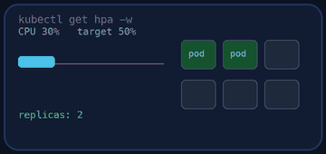
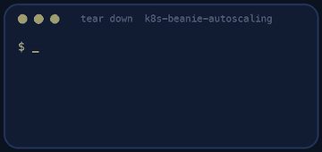

<p align="center"></p>

| | |
|-|-|
| **Time** | 75-90 min |
| **Cost** | free on a local cluster |
| **You need** | Docker, kubectl, git, curl, Python 3 and a local Kubernetes cluster (kind, OrbStack or Docker Desktop) running |

## How this lab works

1. **Fork** this repository to your own GitHub account (button at the top right).
2. Clone **your fork** in your Ubuntu environment (WSL on Windows, your OrbStack machine on Mac).
3. Read the lab below (the same text is in [`LAB.md`](LAB.md)) and follow the mission.
4. Answer the questions in [`SUBMISSION.md`](SUBMISSION.md). Where a question asks for output, paste it in a code block. No screenshots needed.
5. Commit and push. Open the **Actions** tab of your fork (click *I understand my workflows, go ahead and enable them* the first time). The **Lab check** shows what is still missing.
6. When the check is green, **submit the URL of your fork** in the course platform.

> [!NOTE]
> The check only looks at your answers and any files the lab asks you to commit. Your instructor reads your work and may ask you to explain any line.

<p align="center"></p>

## 🎬 The situation

<p align="center"></p>

Beanie works. Then it is noon, a whole office opens the app at the same moment, and the gateway pods hit their CPU ceiling. Latency climbs from 40 ms to 4 seconds, customers refresh, which makes it worse, and the on-call engineer scales the Deployment by hand: `kubectl scale --replicas=10`. At 14:00 nobody remembers to scale it back down, and the cluster stays big all weekend.

Kubernetes can do both of those things by itself, but only if you tell it **how much each pod really needs** (the *request*) and **when to add or remove pods** (a *HorizontalPodAutoscaler*, the HPA). Both numbers are decisions you make with data, not guesses. Today you measure, decide, throw a lunch rush at the cluster, and watch it grow and then shrink without you.

> [!IMPORTANT]
> **Your mission**
> - Measure what the gateway and the menu service really use
> - Set honest CPU requests and write an HPA for each
> - Start the lunch rush and watch pods appear, in numbers and in time
> - Stop the rush and watch the cluster give the pods back
> - Tear down and prove it

**Time:** 75-90 min | **Cost:** free on a local cluster | **You need:** Docker, `kubectl`, git, curl, Python 3 and a local Kubernetes cluster running (kind, OrbStack or Docker Desktop with Kubernetes enabled). Check with `kubectl get nodes`. Give Docker 4 CPUs and 6 GB of memory if you can.

<p align="center"></p>

## Part 0 - Get Beanie running, and a way to measure

Fork this repository, clone your fork, and run:

```bash
./setup.sh
kubectl apply -f k8s/base/
kubectl apply -f load/lunch-rush.yaml
kubectl get pods -n beanie -w
```

`setup.sh` also checks that the **metrics API** works (`kubectl top`) and installs `metrics-server` if it does not. The autoscaler can see nothing without it. `lunch-rush` is a provided load generator that starts with **0 replicas**. Read `load/lunch-rush.yaml.tpl` and `k8s/TODO.md`.

<p align="center"></p>

## Part 1 - Measure

```bash
kubectl top pods -n beanie
```

That is the cost of doing nothing. Now give the service a little work: a single client, a steady trickle.

```bash
kubectl port-forward -n beanie svc/gateway 8000:8000 &
while true; do curl -s -o /dev/null localhost:8000/api/menu; sleep 0.1; done
```

In another terminal, `kubectl top pods -n beanie` a few times. Note the CPU of one `gateway` pod and one `menu` pod while serving about ten requests a second. Stop the loop.

> [!NOTE]
> **Think** `kubectl top` shows CPU in millicores: `50m` is five percent of one core. The **request** you write in the Deployment is not a limit; it is the amount the scheduler *reserves* for the pod, and it is the **100%** that the HPA's percentage is measured against. What happens to the HPA if you request `1000m` for a pod that uses `30m`? And if you request `1m`?

<p align="center"></p>

## Part 2 - Requests and HPAs

1. In `k8s/base/gateway.yaml` and `k8s/base/menu.yaml` set a CPU request between **50m and 250m** that matches what you measured (a pod at rest should sit well below it; a pod doing real work should approach it). Apply.
2. Write `k8s/hpa.yaml` with **two** `HorizontalPodAutoscaler`s (`autoscaling/v2`): one for `gateway`, one for `menu`.
   - at least **2** replicas always (a rush should not start from a single pod), at most between **4 and 10**
   - scale on **CPU utilisation**, target between **40% and 80%**
   - a `behavior.scaleDown.stabilizationWindowSeconds` of **60** (the default is 300, which would make this lab take half an hour)

```bash
kubectl apply -f k8s/
kubectl get hpa -n beanie
kubectl describe hpa -n beanie gateway
```

The HPA shows `<unknown>/60%` for a minute or so, then a real number. If it stays `<unknown>`, read `describe`: the usual cause is a missing CPU **request** on the Deployment, because without a request there is no 100% to measure against.

> [!NOTE]
> **Predict** Before the rush: if the gateway's average CPU is 150% of its request across 2 pods and the target is 60%, how many pods does the HPA want? The formula is `ceil(current replicas × current / target)`. Write your answer, then see how close the cluster gets.

<p align="center"></p>

## Part 3 - The rush

Open two terminals. In the first, watch:

```bash
kubectl get hpa -n beanie -w
```

In the second, start the rush and note the time:

```bash
date; kubectl scale -n beanie deployment/lunch-rush --replicas=3
```

Each rush pod asks the gateway for the menu with 16 threads at once. Watch the HPA's `TARGETS` climb past 100%, `REPLICAS` increase, and new pods go `Pending`, `ContainerCreating`, `Running`, `Ready`. Write down:

1. how many seconds after the start the first **new pod was created**
2. how many seconds after that it was **Ready**
3. the highest number of replicas reached

> [!NOTE]
> **Think** Those two delays are different problems. The first is how often the HPA looks at metrics (about every 15 seconds) and how recent the metrics are. The second is how long a new pod takes to start (pulling the image, starting Python, passing its readiness probe). Which can you shorten, and how? What does this say about starting the autoscaler too late?

<p align="center"></p>

## Part 4 - The rush ends

```bash
kubectl scale -n beanie deployment/lunch-rush --replicas=0
```

Keep watching. The metrics drop immediately, but the pods do not: the HPA waits out the **stabilisation window** before it removes any. Then it removes them gradually.

> [!NOTE]
> **Think** The window exists to stop *flapping*: scale down at the first quiet second, the next wave arrives, scale up, scale down... Each cycle costs a pod start and risks errors for real users. What is the price of a window that is too long? Too short?

<p align="center"></p>

## Part 5 - Prove it

<p align="center"></p>

```bash
./verify.sh
```

It reads your HPAs and requests, then runs the lunch rush itself and measures: the Deployments must grow beyond their minimum under load, and shrink back after it. This takes about **5 to 8 minutes**. Fix what is red and run it again until it ends with **ALL CHECKS PASSED**.

> [!TIP]
> **Stuck?** `<unknown>` targets: missing CPU request, or metrics-server not ready. Nothing scales: your request is too large for the load (the HPA is working, the percentage never reaches the target), or the nodes have no room (pods `Pending`: `kubectl describe pod`). It scales up but never down: the load generator is still running, or the window is long. Verify says the metrics API is missing: run `./setup.sh` again.

<p align="center"></p>

## Level up (optional)

- Add `memory` as a second metric. How does the HPA combine two metrics?
- Look at `kubectl get events -n beanie` during the rush. Find the `SuccessfulRescale` events and read their messages.
- Scale `payments` on something other than CPU. It spends its time waiting for a pretend bank; CPU stays low however busy it is. Which signal would you use (requests in flight, queue length), and what do you need to install to use it (Prometheus Adapter or KEDA)?
- What would stop the HPA from asking for 10 pods when the nodes only have room for 6? Which component adds nodes?

<!-- teardown:start (generated by labs.py, do not edit) -->
## Tear down (mandatory)

<p align="center"></p>

Resources left behind cost money, keep doors open and pollute the next lab. Removing what you created is part of the job, so it is part of the submission: **you must prove it is gone**.

Do this **last**, after you have pasted your `verify` output into `SUBMISSION.md` (once you tear down, the lab can no longer be verified).

1. Run `./teardown.sh`. It deletes the `beanie` namespace (including the load generator) and the cloned Beanie source.

Then run the proof:

```bash
./verify-teardown.sh
```

It prints a list of checks and must end with **TEARDOWN VERIFIED**. If it reports leftovers, remove them and run it again. Paste the full output in your submission.
<!-- teardown:end -->

<!-- submission:start (generated by labs.py, do not edit) -->
## 📬 Submission

Answer the questions in `SUBMISSION.md` in **your fork** (paste output in code blocks where asked), push, then submit the **URL of your fork**.

**Files to commit**

- `k8s/` with your Deployments, Services and HPA
- `notes.md` with your commands and what you saw (optional)

**Questions to answer**

1. Paste `kubectl top pods` at rest. How did you choose the CPU request for the gateway? What does an HPA percentage mean, a percentage of what?
2. Paste your HPA manifest. Why `minReplicas` of 2? What happens if the request is missing from the Deployment?
3. Run the lunch rush and paste `kubectl get hpa -w` over time. How many seconds passed between the load starting and the first new pod, and between the new pod being created and being Ready? Which one can you shorten and how?
4. Stop the load and watch it shrink. Why does it take minutes? What is the stabilization window protecting you from?
5. The HPA scales on CPU. Name a Beanie service where CPU would be the wrong signal and say which signal you would scale on.
6. What is the difference between the HPA and the cluster autoscaler? What happens when the HPA wants 10 pods and the nodes are full?
7. Paste the output of `./verify.sh`. It must end with **ALL CHECKS PASSED**.
8. **Tear down.** Paste the output of `./verify-teardown.sh`. It must end with **TEARDOWN VERIFIED**.
<!-- submission:end -->
